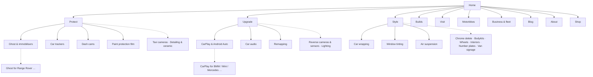

# Information architecture: site map, menu, footer, URLs

_Round 2, step 5 · 8 Nov 2026 · Built from `content-inventory.md`, `card-sort.md` (groups A + Dani's tiers),
competitor menus and Mobbin. Proposal for Dani's approval with the menu/footer concept._

## Site map

Solid lines = in the menu (tier 1) · dotted = hub + footer (tier 2) or contextual only (tier 3, car-specific).

## Pages and tiers
| Tier | Where it shows | Pages |
|---|---|---|
| **1 · Menu** (10) | Header menu panels + hubs + footer | Protect: **Ghost & immobilisers, Car trackers, Dash cams, Paint protection film** · Upgrade: **CarPlay & Android Auto, Car audio, Remapping** · Style: **Car wrapping, Window tinting, Air suspension** |
| **2 · Hub + footer** (12) | Hub pages ("All Protect services") + footer columns | Taxi cameras (TfL), Detailing & ceramic coating, Reverse cameras & sensors, Ambient lighting & starlights, Chrome delete, Bodykits & exterior parts, Wheel refurb & calipers, Interiors, Number plates, Van signage & livery |
| **Hubs** (5) | Menu (verbs) + footer | Protect, Upgrade, Style, Motorbikes, Business & fleet |
| **3 · Contextual** (grows) | Links from related service pages, blog posts and the XML sitemap only | Car-specific (CarPlay for BMW/Mini/Mercedes/Audi/VW…, Ghost for Range Rover/BMW…), comparison and FAQ pages |
| **Brand & support** | Menu (Builds, Visit) or footer | Builds, Visit, About, Blog (+ articles), Shop, Prices (TBC), Privacy, Cookies, Terms |

Why these 10 in the menu: the highest search demand (trackers, Ghost, dash cams, wraps, remapping, audio), the most-viewed
page today (CarPlay), Hyped Up's signature work (air suspension) and the quick earners (tint). PPF sits in Protect because
the name says it.

## URLs
| Page type | Pattern | Example |
|---|---|---|
| Hub | `/<verb>` | `/protect`, `/upgrade`, `/style` |
| Service | `/<service>` (flat: short, keyword-rich, survives regrouping) | `/car-trackers`, `/ghost-immobiliser`, `/car-wrapping`, `/air-suspension` |
| Car-specific | `/<service>/<make>` | `/carplay/bmw`, `/ghost-immobiliser/range-rover` |
| Audience hub | `/<audience>` | `/motorbikes`, `/business` |
| Blog | `/blog`, `/blog/<slug>` | `/blog/how-much-does-a-car-wrap-cost-uk` |
| Builds | `/builds` (later `/builds/<slug>`) | |
| Other | `/about`, `/contact`, `/shop`, `/prices`, `/privacy`, `/cookies`, `/terms` | |
Rules: lowercase, hyphens, no dates, one address per page (no `www` duplicate: `www` redirects to the bare domain).

## Menu
**Desktop header:** logo · **Protect ▾ · Upgrade ▾ · Style ▾** · Builds · Contact · [**Get a quote**] (WhatsApp) _("Visit" renamed "Contact", Dani 8 Nov)_
- Each ▾ panel: its tier-1 services (name + "from £" + one line), one build photo, a "Not sure? Send us your idea" box,
  and **"All Protect services →"** (the hub, where tier-2 pages live).
- Blog, About, Shop, Motorbikes and Business live in the footer and on the hubs (keeps the bar to 5 words + 1 button).

**Mobile:** logo · Menu · (sticky Quote after the hero)
- Full-screen menu: **Protect → Upgrade → Style →** in big type (each opens its list), then small links:
  Motorbikes · Business · Builds · Blog · About · Shop · Visit. **WhatsApp + Call fixed at the bottom.**

## Footer
| Column | Links |
|---|---|
| Protect | all Protect pages (tier 1 + 2) |
| Upgrade | all Upgrade pages |
| Style | all Style pages |
| More | Motorbikes · Business & fleet · Builds · Blog · Shop |
| Hyped Up | About · Contact · Instagram · TikTok · Facebook · LinkedIn |
| Find us | Address (copy) · map link · hours · phone · WhatsApp · email |
Bottom row: © Hyped Up Ltd · company no. 14086991 · Privacy · Cookies · Terms · cookie settings. Base: giant "HYPED UP" wordmark (decided).

## Redirects (old → new)
| Old | New |
|---|---|
| `/` and `www.hypedup.uk/`, `/hyped-up`, `/hypedup` | `/` |
| `/vehicle-security` | `/protect` |
| `/multimedia-upgrade` | `/carplay` |
| `/audio-upgrade-electronics` | `/car-audio` |
| `/wrapping-ppf-tinting` | `/style` |
| `/vehicle-remapping-tuning` | `/remapping` |
| `/air-suspension` | `/air-suspension` |
| `/hyped-up-apparel` | `/shop` |
| `/contact-us` | `/contact` |
| `/privacy-policy` | `/privacy` |
| `/blog` | `/blog` |
| `/hyped-up/f/<slug>`, `/f/<slug>`, `/blog/f/<slug>` | `/blog/<clean-slug>` (all 15 posts, all three patterns) |

## Internal linking rules
- Every service page links to: its hub, 2–3 related services, 1–3 blog guides, and its car-specific pages.
- Every blog post links to 1–2 service pages.
- Every car-specific page links back to its service page and 2 sibling makes. **No orphan pages.**
- Breadcrumbs on all inner pages (Home › Protect › Car trackers).
