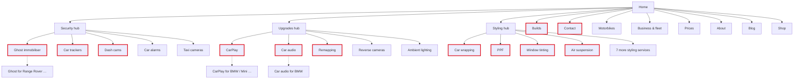

# Information architecture v2: site map, navigation, hierarchy, flows, URLs

_9 Nov 2026 · Replaces v1 (8 Nov, in git history). Built with the `information-architecture` skill template from
`content-inventory.md` (v2), `card-sort.md` (label test v2), `user-journeys.md`, `keyword-map.md` and Dani's rules.
**For review with Dani (all together).**_

## Decisions this IA follows
- Group labels **Security · Upgrades · Styling** (label test v2; the homepage line stays "Protect it. Upgrade it. Style it.").
- **Menu stays simple:** groups open straight onto their tier-1 services; hubs are **not** in the menu.
- **Hub pages list every service of their group, exactly as the footer column does** (Dani, 9 Nov): one shared list feeds both.
- Main action everywhere: **Contact us** → `/contact` (form: WhatsApp or email); phones also get a floating WhatsApp button.
- **No area pages** (Dani, 9 Nov). Dark only. No prices in the menu.

## Skill questions, with the recommended answers (for Dani to confirm)
| Question | Recommended answer |
|---|---|
| Primary things users do (ranked) | 1 check open/where · 2 find a service + price · 3 see work · 4 send an enquiry · 5 read a guide |
| Navigation depth | **3 levels max**: group → service → car-specific (car-specific never in the menu) |
| Content that grows | Builds, blog, car-specific pages; services and hubs are fixed |
| Distinct user types | Car owners (default), motorbike riders, business/taxi → two audience hubs |
| The "80% page" | **Service pages** (where search, AI and partners land) |

## Site map
- Home `/`
  - **Security** hub `/security` *(footer + breadcrumbs + in-page links)*
    - Ghost immobiliser `/ghost-immobiliser` **[menu]** (Metablok, Scorpion as sections)
      - Ghost for Range Rover / BMW / Mercedes `/ghost-immobiliser/<make>` *(tier 3)*
    - Car trackers `/car-trackers` **[menu]**
    - Dash cams `/dash-cams` **[menu]**
    - Car alarms `/car-alarms`
    - Taxi cameras (TfL) `/taxi-cameras`
  - **Upgrades** hub `/upgrades`
    - CarPlay & Android Auto `/carplay` **[menu]**
      - CarPlay for BMW / Mini / Mercedes / Audi `/carplay/<make>` *(tier 3)*
    - Car audio `/car-audio` **[menu]** (sound deadening, boot builds as sections)
      - Car audio for BMW `/car-audio/bmw` *(tier 3)*
    - Remapping `/remapping` **[menu]** (bike remaps, performance parts as sections)
    - Reverse cameras & sensors `/reverse-cameras`
    - Ambient lighting & starlights `/ambient-lighting`
  - **Styling** hub `/styling`
    - Car wrapping `/car-wrapping` **[menu]**
    - Paint protection film `/paint-protection-film` **[menu]**
    - Window tinting `/window-tinting` **[menu]**
    - Air suspension `/air-suspension` **[menu]**
    - Chrome delete `/chrome-delete`
    - Bodykits `/bodykits`
    - Wheel refurb & calipers `/wheel-refurb`
    - Interiors `/interiors`
    - Detailing & ceramic `/detailing`
    - Number plates `/number-plates`
    - Van signage & livery `/van-signage`
  - Motorbikes `/motorbikes` *(audience hub: links into the services above)*
  - Business & fleet `/business` *(audience hub)*
  - Builds `/builds` **[menu]**
    - Build `/builds/<slug>` *(later)*
  - Contact `/contact` **[menu]**
  - Prices `/prices`
  - About `/about`
  - Blog `/blog` · categories `/blog/<category>` · post `/blog/<slug>`
  - Shop `/shop`
  - Privacy `/privacy` · Cookies `/cookies` · Terms `/terms`

**Counts:** 10 menu services · 11 more services · 3 group hubs · 2 audience hubs · 6 brand/support · 3 legal = **36 pages at launch**, then car-specific pages and builds.

Red outline = in the menu.

## Navigation model
- **Primary (desktop header):** logo · **Security ▾ · Upgrades ▾ · Styling ▾** · Builds · Contact · status ("Open today 10:00–18:00") · [**Contact us**]. Each ▾ lists its tier-1 services only (no prices, no hub link).
- **Phone:** logo · Menu. Full-screen menu: **Security / Upgrades / Styling** (tap to open the tier-1 list) · Builds · then small links Motorbikes · Business & fleet · Prices · Blog · About · Shop · hours line · bottom bar **Contact us + WhatsApp + Call**. Floating WhatsApp button on every page.
- **Secondary:** breadcrumbs on every inner page (Home › Security › Car trackers); hub pages list every service in their group; each service page links 2–3 related services, 1–3 blog guides, its car-specific pages.
- **Footer (the full index, = the hubs):**

| Security | Upgrades | Styling | More |
|---|---|---|---|
| All Security services → | All Upgrades → | All Styling → | Motorbikes |
| Ghost immobiliser | CarPlay & Android Auto | Car wrapping | Business & fleet |
| Car trackers | Car audio | Paint protection film | Builds |
| Dash cams | Remapping | Window tinting | Prices |
| Car alarms | Reverse cameras & sensors | Air suspension | Blog |
| Taxi cameras (TfL) | Ambient lighting & starlights | Chrome delete | About |
| | | Bodykits | Shop |
| | | Wheel refurb & calipers | |
| | | Interiors | |
| | | Detailing & ceramic | |
| | | Number plates | |
| | | Van signage & livery | |

Plus Find us (address, hours, phone/WhatsApp/email, socials), legal row, HYPED UP wordmark. Phone: columns fold into rows.

## Content hierarchy (summary; full blocks in `content-model.md`)
- **Home:** 1 what we do + one action (hero video) · 2 the three groups · 3 recent builds · 4 how a job works · 5 proof (reviews, Hypa) · 6 visit + contact.
- **Hub:** 1 what this group covers · 2 **every service in the group** (same list as the footer) · 3 "which one do I need?" · 4 FAQ · 5 contact.
- **Service:** 1 answer + "from £" + one action · 2 how it works / options · 3 proof (builds, reviews) · 4 price detail · 5 FAQ + legal note · 6 related + contact.
- **Contact:** 1 form v2 · 2 map + directions · 3 hours + phone.

## User flows (critical paths)
1. **Search → service → contact:** lands on `/ghost-immobiliser` → reads price + how it works → **Contact us** → `/contact?service=security` (pre-ticked) → WhatsApp or email.
2. **Maps → visit:** Home → status in header → Contact → **Get directions** (Business Profile).
3. **Instagram → builds → contact:** `/builds` → filter → build → its service page → Contact.
4. **Unsure → hub → service:** footer "All Security services" → hub comparison → service → Contact.
- If the service page can't answer "will it fit my car?" → car-specific page or the form's "Your car" field.

## Naming conventions
| Concept | UI label | Notes |
|---|---|---|
| Group 1 | **Security** | not "Protect" (menu); "Protect it." stays in the headline |
| Group 2 | **Upgrades** | matches "audio upgrades" searches |
| Group 3 | **Styling** | |
| Main action | **Contact us** | everywhere; never "Get a quote" / "Start your build" |
| Enquiry page | **Contact** | not "Visit" |
| Work gallery | **Builds** | |
| Prices | **from £** | never exact quotes on the site |
| The workshop | Unit 22, Bolina Road, SE16 | address said once per screen |

## Component reuse map
| Component | Used on | Variation |
|---|---|---|
| Header + phone menu + floating WhatsApp | all pages | current group underlined |
| Footer (one service list) | all pages | same list renders the hubs |
| Service list block | hubs, footer | hub = cards with "from £"; footer = links |
| "From £" price block | service pages, Prices | |
| FAQ (+ FAQ schema) | hubs, services, blog | |
| Builds strip | home, services | filtered by service |
| Contact band | every page except Contact | carries `?service=` |
| Breadcrumbs | all inner pages | |

## Content growth plan
- **Builds:** filter by group (Security / Upgrades / Styling) and later by make; a build page when a job has 4+ photos.
- **Blog:** categories = the three groups + "Law & guides"; 2 posts/week; each post links to its service page.
- **Car-specific pages:** add when a make gets 2+ real jobs with photos (start: CarPlay BMW/Mini/Mercedes/Audi, Car audio BMW).

## URL strategy
- Lowercase, hyphens, no dates, no trailing slash; one address per page (`www` → bare domain).
- Hubs `/<group>` · services `/<service>` (flat) · car-specific `/<service>/<make>` · builds `/builds/<slug>` · blog `/blog/<slug>`.
- Query parameter: `?service=` on `/contact` only (not indexed).

## Redirects (old → new)
| Old | New |
|---|---|
| `www.hypedup.uk/*` | `hypedup.uk/*` |
| `/hyped-up`, `/hypedup` | `/` |
| `/vehicle-security` | `/security` |
| `/multimedia-upgrade` | `/carplay` |
| `/audio-upgrade-electronics` | `/car-audio` |
| `/wrapping-ppf-tinting` | `/styling` |
| `/vehicle-remapping-tuning` | `/remapping` |
| `/air-suspension` | `/air-suspension` |
| `/hyped-up-apparel` | `/shop` |
| `/contact-us` | `/contact` |
| `/privacy-policy` | `/privacy` |
| `/hyped-up/f/<slug>`, `/f/<slug>`, `/blog/f/<slug>` | `/blog/<clean-slug>` (all 15 posts) |
